<p align="center">
  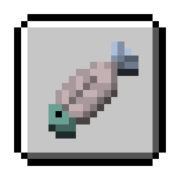
</p>

<h1 align="center">BetaAchievement</h1>

<p align="center">Bring all 16 original achievements to the server side of Minecraft Beta 1.7.3, with persistent progress and competitive speedruns.</p>

<p align="center">
  
  
  
  
  <a href="https://bstats.org/plugin/bukkit/BetaAchievement/35134"></a>
</p>

<p align="center"><b>English</b> · <a href="https://github.com/che11111/BetaAchievement/blob/main/README-zh.md">简体中文</a></p>
<p align="center">
  <a href="https://github.com/che11111/BetaAchievement/releases">Download</a> ·
  <a href="https://github.com/che11111/BetaAchievement">Source & Full Docs</a> ·
  <a href="https://github.com/che11111/BetaAchievement/issues">Report an Issue</a>
</p>

BetaAchievement is a server-side achievement plugin for Minecraft Beta 1.7.3 Project Poseidon. It evaluates and persists all 16 original achievements on the server, supports SQLite and MySQL/MariaDB, and exposes an API for querying achievement progress.

| Preview | Features |
| :---: | :--- |
| <a href="https://che11111.github.io/BetaAchievement/">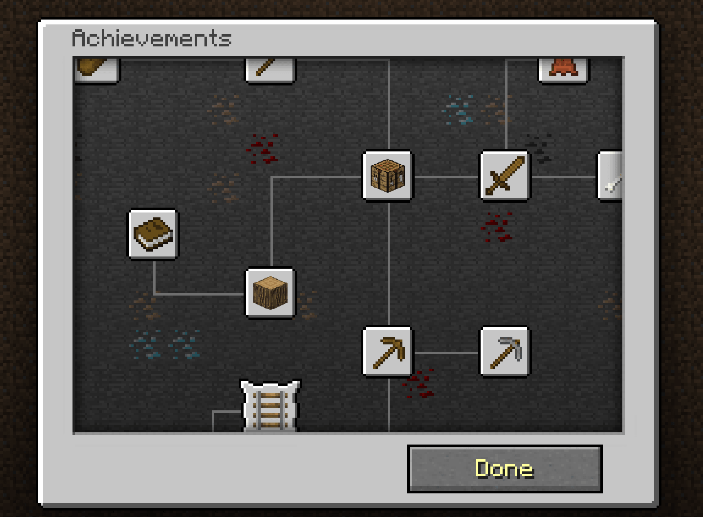</a> | • Detect all 16 original achievements on the server and verify achievement parent requirements.<br>• Adapt to missing inventory, crafting, and special-behavior events on Beta 1.7.3 servers.<br>• Broadcast unlocks server-wide and optionally output them to the console.<br>• Record cumulative time, split times, run history, personal bests, and a server leaderboard for each 16/16 run.<br>• Persist players, runs, and individual progress using SQLite or MySQL/MariaDB.<br>• Expose current progress, full-completion rank, and run data queries to other plugins through the API. |

## Server-Side Achievement Detection

Client and server achievement states are not synchronized because Beta 1.7.3 evaluates achievements only on the client. There are 16 achievements in total, and some triggers differ slightly because the server does not receive every event the client uses.

| Icon | # | Achievement ID | Achievement | Requirement | Detection | Parent |
| :---: | :--- | :--- | :--- | :--- | :--- | :--- |
| 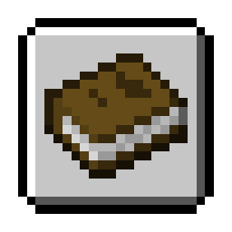 | 1 | `openInventory` | Taking Inventory | Pick up any item | Unlocks when the player picks up any item. Opening the inventory with E in Beta 1.7.3 does not send a packet and produces no server event. | None |
| 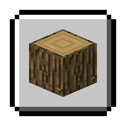 | 2 | `mineWood` | Getting Wood | Break a tree and pick up the dropped wood block | Unlocks when the player picks up item ID 17 (wood). | Taking Inventory |
| 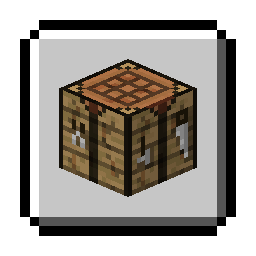 | 3 | `buildWorkBench` | Benchmarking | Craft a crafting table from four wood planks | Unlocks when item ID 58 (crafting table) is taken from a crafting output slot. | Getting Wood |
| 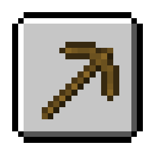 | 4 | `buildPickaxe` | Time to Mine! | Craft a pickaxe from planks and sticks | Unlocks when any pickaxe is taken from a crafting output slot: iron 257, wood 270, stone 274, diamond 278, or gold 285. | Benchmarking |
| 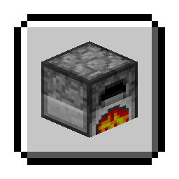 | 5 | `buildFurnace` | Hot Topic | Craft a furnace from eight cobblestone | Unlocks when item ID 61 (furnace) is taken from a crafting output slot. | Time to Mine! |
| 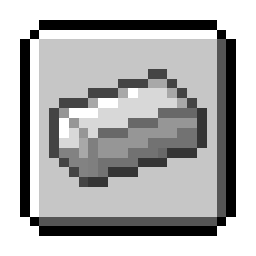 | 6 | `acquireIron` | Acquire Hardware | Smelt an iron ingot | Unlocks when item ID 265 (iron ingot) is taken from a furnace result slot. | Hot Topic |
| 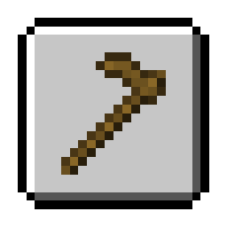 | 7 | `buildHoe` | Time to Farm! | Craft a hoe from planks and sticks | Unlocks when any hoe is taken from a crafting output slot: wood 290, stone 291, iron 292, diamond 293, or gold 294. | Benchmarking |
| 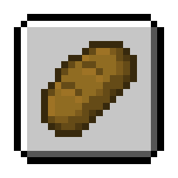 | 8 | `makeBread` | Bake Bread | Craft bread from wheat | Unlocks when item ID 297 (bread) is taken from a crafting output slot. | Time to Farm! |
| 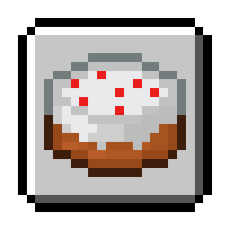 | 9 | `bakeCake` | The Lie | Craft a cake from wheat, sugar, milk, and eggs | Unlocks when item ID 354 (cake) is taken from a crafting output slot. | Time to Farm! |
| 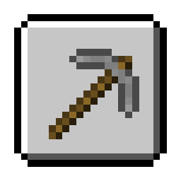 | 10 | `buildBetterPickaxe` | Getting an Upgrade | Craft a pickaxe better than a wooden one | Unlocks when an iron 257, stone 274, diamond 278, or gold 285 pickaxe is taken from a crafting output slot. | Time to Mine! |
|  | 11 | `cookFish` | Delicious Fish | Catch and cook a fish | Unlocks when item ID 350 (cooked fish) is taken from a furnace result slot. | Hot Topic |
| 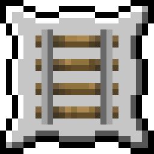 | 12 | `onARail` | On A Rail | Travel by minecart at least 1 km (1,000 m) from the boarding point | Records the boarding position and uses 3D straight-line distance: `dx² + dy² + dz² >= 1000000`, or 1,000 m. Changing worlds resets the starting position. | Acquire Hardware |
| 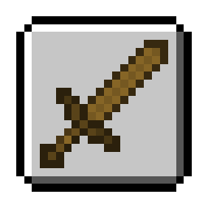 | 13 | `buildSword` | Time to Strike! | Craft a sword from planks and sticks | Unlocks when any sword is taken from a crafting output slot: iron 267, wood 268, stone 272, diamond 276, or gold 283. | Benchmarking |
| 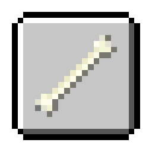 | 14 | `killEnemy` | Monster Hunter | Attack and kill a hostile mob | Unlocks when a hostile mob damaged by the player dies within 30 seconds. | Time to Strike! |
| 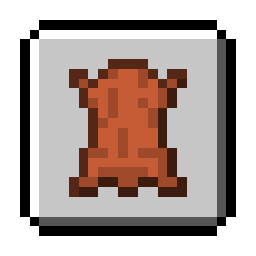 | 15 | `killCow` | Cow Tipper | Obtain leather | Unlocks when the player picks up item ID 334 (leather). | Time to Strike! |
| 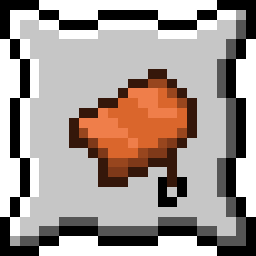 | 16 | `flyPig` | When Pigs Fly | Ride a pig off a cliff | Unlocks on fall damage greater than 2, corresponding to a fall of more than 5 blocks, when the damaged entity is a pig carrying a player. | Cow Tipper |

Normal gameplay requires parent achievements. `/ach grant` automatically grants any missing parents. Admin grants, revokes, and resets invalidate the current run for leaderboard eligibility.

## Compatibility

| Component | Requirements and Compatibility |
| --- | --- |
| Server | Project Poseidon based on Minecraft Beta 1.7.3 |
| Java | Compiled for Java 8 |
| Storage | SQLite (default) or MySQL/MariaDB |
| Build dependency | `com.legacyminecraft.poseidon:poseidon-craftbukkit:1.1.8` (`provided`) |

## Configuration

The configuration file is `plugins/BetaAchievement/config.yml`.

```yaml
language:
  # auto, zh, or en. In-game messages are always English.
  console: auto

database:
  # When false, achievements are kept in memory and lost on restart.
  enabled: true

  # Storage type: sqlite or mysql.
  type: sqlite
  file: achievements.db

  # MySQL/MariaDB settings, used when type is mysql.
  host: 127.0.0.1
  port: 3306
  database: minecraft
  username: minecraft
  password: change_me
  table-prefix: beta_achievements_

runs:
  # Maximum active time for run 2 and later, in hours.
  # Set to 0 to disable the timeout.
  repeat-timeout-hours: 12

announce:
  broadcast: true
  console: true

bstats:
  # Send anonymous usage statistics. No player names or chat messages are sent.
  enabled: true
```

In-game messages always use the ASCII-only `lang/game.yml`, because Beta 1.7.3 clients cannot render languages other than English. Console logs and console command replies automatically use `lang/console-zh.yml` or `lang/console-en.yml` according to `language.console`; `auto` follows the server JVM language.

## Achievement Runs

The first time a player joins, they receive run 1 in the `READY` state. When the player unlocks their first achievement, normally `openInventory`, the run changes to `ACTIVE` and starts timing. The total time is saved after all 16 achievements are completed.

After completing a run, use `/ach run next` to create the next run:

- Completed runs and manually abandoned runs remain in history. Active runs numbered 2 or later are deleted under the timeout rule if they are not completed within 12 hours.
- A new run starts at 0/16.
- Every run still starts timing when its first achievement is completed.
- Timing uses real server time and continues while the player is offline or the server is stopped.
- Only players who have completed at least one 16/16 run can use `/ach run next` and `/ach run abandon`.
- A `READY` run cannot be abandoned. An active run numbered 2 or later is deleted if it remains incomplete after 12 hours.

The leaderboard includes only `COMPLETED` runs, sorts them by total duration, and keeps each player's fastest run. Admin grants, revokes, and resets close the current run and remove it from leaderboard eligibility. Debug mode never writes data.

## Commands

`/ach` is the only alias for `/achievement`.

### Player Commands

| Command | Description |
|---|---|
| `/ach` | View your progress in the current run |
| `/ach run info` | View elapsed time and all splits for the current run |
| `/ach run next` | Start another run after completing all achievements |
| `/ach run abandon` | Abandon an active run numbered 2 or later |
| `/ach history` | View your 10 most recent runs |
| `/ach pb` | View your personal best |
| `/ach top [count]` | View the server leaderboard, with at most 25 entries |

### Administrator Commands

| Command | Description | Permission |
|---|---|---|
| `/ach check <player>` | View an online player's achievement progress | `betaachievement.view.others` |
| `/ach pb <player>` | View an online player's personal best | `betaachievement.view.others` |
| `/ach grant <player> <achievement-id>` | Grant one achievement and its parents; invalidates the current run | `betaachievement.grant` |
| `/ach grantall <player>` | Grant all 16 achievements; invalidates the current run | `betaachievement.grantall` |
| `/ach revoke <player> <achievement-id>` | Revoke one achievement; invalidates the current run | `betaachievement.revoke` |
| `/ach reset <player>` | Invalidate the current run and create a new `READY` run | `betaachievement.reset` |
| `/ach debug <achievement-id>` | Enable achievement debug mode | `betaachievement.debug` |
| `/ach debug` | Disable debug mode | `betaachievement.debug` |

The target player must be online. `betaachievement.admin` can replace all of the specific permissions above. If a player's data is still loading, administrative actions are queued and run in order after loading finishes.

Debug mode applies only to the administrator who ran the command. It ignores parent requirements and reports detection information when triggered, but does not write to the database or change leaderboard data.

## Plugin API

Other plugins can obtain the API from the main plugin class:

```java
BetaAchievement beta = (BetaAchievement) getServer()
        .getPluginManager()
        .getPlugin("BetaAchievement");
BetaAchievementApi api = beta.getApi();
```

The API provides cached and persistent progress queries, full-completion rank lookup, personal bests, leaderboard entries, run history, and run splits. Database reads are asynchronous, and callbacks return to the Bukkit main thread.

Public API classes are under `dev.che1s.betaachievement.api`. Run data classes are under `dev.che1s.betaachievement.run`.

For the complete configuration, command reference, and Java examples, see the [full English documentation](https://github.com/che11111/BetaAchievement/blob/main/README.md) or the [简体中文文档](https://github.com/che11111/BetaAchievement/blob/main/README-zh.md).

## Sponsorship and Support

If this project is useful to you, you can support development through Ko-fi or Afdian. Sponsors can receive help with installation, configuration, and troubleshooting.

<p align="center">
  <a href='https://ko-fi.com/J5C529ZWWL' target='_blank'></a>
  <a href='https://afdian.com/a/sss000' target='_blank'></a>
</p>
