<p align="center">
  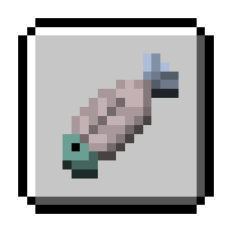
</p>

<h1 align="center">BetaAchievement</h1>

<p align="center">为 Minecraft Beta 1.7.3 / Project-Poseidon 提供原版成就判定、持久化与竞速排行榜。</p>

<p align="center">
  
  
  
  
</p>

<p align="center">
  <a href="#服务端成就判定">成就判定</a> · <a href="#功能概览">功能</a> · <a href="#快速开始">快速开始</a> · <a href="#配置">配置</a> · <a href="#成就竞速">成就竞速</a> · <a href="#指令">指令</a> · <a href="#插件-api">插件 API</a>
</p>

BetaAchievement 是一个面向 Minecraft Beta 1.7.3 / Project-Poseidon 的服务端成就插件。它在服务端判定并持久化原版 16 个成就；支持 SQLite 和 MySQL/MariaDB，并提供成就进度查询 API。

## 服务端成就判定

服务端的“成就”与客户端的“成就”并不同步，这是因为 Beta 1.7.3 的“成就”判定只在客户端完成。一共 16 个成就，因服务端缺少一些事件，部分成就的判定事件有稍微改变。

| 图标 | **#** | 成就 ID | 中文名 | 英文名 | 获取要求 | 如何判断 | 前置成就 |
| :---: | :--- | :--- | :--- | :--- | :--- | :--- | :--- |
| 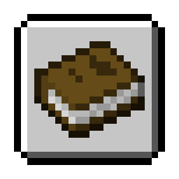 | 1 | `openInventory` | 打开物品栏 | Taking Inventory | 捡起任意一个物品 | 监听玩家捡起任意物品即触发（因 Beta 1.7.3 客户端按 E 打开背包不发送任何数据包，服务端没有“打开物品栏”事件，故改为捡取物品触发） | 无 |
| 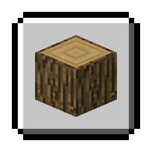 | 2 | `mineWood` | 获得木头 | Getting Wood | 破坏树木并捡起掉落的木头方块 | 捡起物品 ID 为 17（木头）时触发 | 打开物品栏 |
| 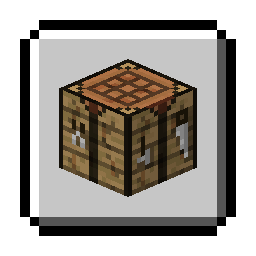 | 3 | `buildWorkBench` | 这是？工作台！ | Benchmarking | 用四块木板合成一个工作台 | 监听工作台容器在合成输出槽点击取出物品 ID 为 58（工作台）时触发 | 获得木头 |
| 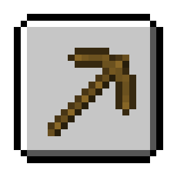 | 4 | `buildPickaxe` | 采矿时间到！ | Time to Mine! | 用木板和木棍合成一把镐 | 在工作台输出槽点击取出镐（铁镐 257、木镐 270、石镐 274、钻石镐 278、金镐 285）时触发 | 这是？工作台！ |
| 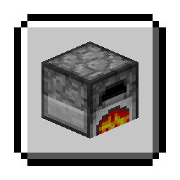 | 5 | `buildFurnace` | “热”门话题 | Hot Topic | 用八块圆石合成一个熔炉 | 在工作台输出槽点击取出物品 ID 为 61（熔炉）时触发 | 采矿时间到！ |
| 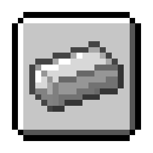 | 6 | `acquireIron` | 来硬的 | Acquire Hardware | 冶炼出铁锭 | 在熔炉容器结果槽点击取出物品 ID 为 265（铁锭）时触发 | “热”门话题 |
| 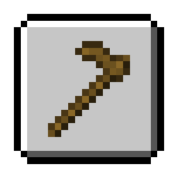 | 7 | `buildHoe` | 耕种时间到！ | Time to Farm! | 用木板和木棍合成一把锄头 | 在工作台输出槽点击取出锄头（木锄 290、石锄 291、铁锄 292、钻石锄 293、金锄 294）时触发 | 这是？工作台！ |
| 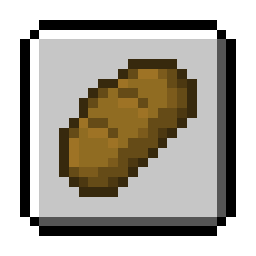 | 8 | `makeBread` | 烤面包 | Bake Bread | 用小麦合成面包 | 在工作台输出槽点击取出物品 ID 为 297（面包）时触发 | 耕种时间到！ |
| 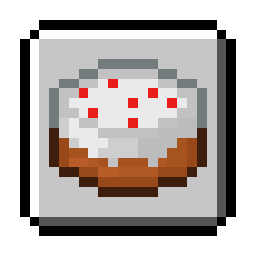 | 9 | `bakeCake` | 蛋糕是个谎言 | The Lie | 用小麦、糖、牛奶和鸡蛋合成蛋糕 | 在工作台输出槽点击取出物品 ID 为 354（蛋糕）时触发 | 耕种时间到！ |
| 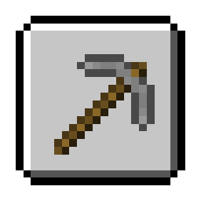 | 10 | `buildBetterPickaxe` | 获得升级 | Getting an Upgrade | 合成一把比木镐更好的镐 | 在工作台输出槽点击取出铁镐 257、石镐 274、钻石镐 278 或金镐 285 时触发 | 采矿时间到！ |
|  | 11 | `cookFish` | 美味的鱼儿 | Delicious Fish | 钓到并烤熟一条鱼 | 在熔炉容器结果槽点击取出物品 ID 为 350（熟鱼）时触发 | “热”门话题 |
| 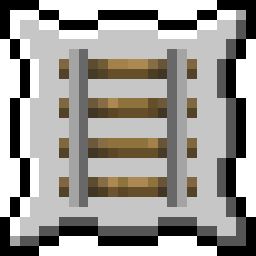 | 12 | `onARail` | 在铁路上 | On A Rail | 乘坐矿车到达离上车位置至少 1 公里（1000 米）的地方 | 监听并记录玩家上车时的位置，按三维直线距离计算（dx²+dy²+dz² ≥ 1000000，即 1000 米）时触发；换世界会重新记录起点 | 来硬的 |
| 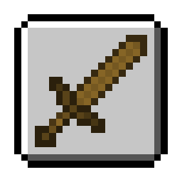 | 13 | `buildSword` | 出击时间到！ | Time to Strike! | 用木板和木棍合成一把剑 | 在工作台输出槽点击取出剑（铁剑 267、木剑 268、石剑 272、钻石剑 276、金剑 283）时触发 | 这是？工作台！ |
| 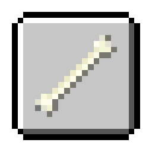 | 14 | `killEnemy` | 怪物猎人 | Monster Hunter | 攻击并消灭一个敌对怪物 | 玩家造成伤害的怪物在 30 秒内死亡即触发 | 出击时间到！ |
| 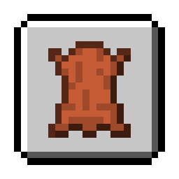 | 15 | `killCow` | 斗牛士 | Cow Tipper | 获得一些皮革 | 监听捡起物品 ID 为 334（皮革）时触发 | 出击时间到！ |
| 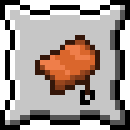 | 16 | `flyPig` | 当猪飞的时候 | When Pigs Fly | 骑着猪从悬崖坠落 | 监听坠落伤害，伤害值 > 2（对应坠落高度 > 5 格）且受伤实体为猪、猪的乘客为玩家时触发 | 斗牛士 |

普通游戏触发必须满足前置成就条件；管理员使用 `grant` 时会自动补齐缺失的前置成就。[achievements.md](src/main/resources/achievements.md) 保留了同样内容的随插件发行版本。


## 兼容性

- 服务端：Beta 1.7.3 Project-Poseidon 
- Java：编译目标为 Java 8。
- 数据存储：SQLite（默认）或 MySQL/MariaDB。
- Maven 依赖：`com.legacyminecraft.poseidon:poseidon-craftbukkit:1.1.8`（`provided`）。

从旧版升级时，如果 `plugins/BetaAchievements` 存在且 `plugins/BetaAchievement` 尚不存在，插件会自动迁移整个数据目录。若两个目录同时存在，插件会停止启动，避免错误选择数据库。旧的 `betaachievements.*` 权限仍会被代码识别，但新配置应使用 `betaachievement.*`。


## 配置

配置文件位于 `plugins/BetaAchievement/config.yml`。完整配置如下：

```yaml
# 修改配置后请重启服务器。
# 从旧版本升级前请先备份 achievements.db 或对应 MySQL 数据库。

database:
  # 是否启用持久化。
  # false：插件仍可使用，但成就只保存在内存中，重启后清空。
  enabled: true

  # sqlite：使用本文件下方的 SQLite 配置。
  # mysql：使用本文件下方的 MySQL/MariaDB 配置。
  type: sqlite

  # SQLite 数据库文件，相对 plugins/BetaAchievement/ 目录。
  file: achievements.db

  # 以下五项只在 database.type 为 mysql 时使用。
  host: 127.0.0.1
  port: 3306
  database: minecraft
  username: minecraft
  password: change_me

  # 数据表前缀，只能包含英文字母、数字和下划线。
  table-prefix: beta_achievements_

runs:
  # 第 2 轮及以后进入 ACTIVE 后的最长挑战时间，单位为小时。
  # 超时后会删除该活动轮次及其 run_progress 数据。
  # 第 1 轮、READY 轮次和所有 COMPLETED 轮次不会被删除。
  # 设置为 0 可关闭自动超时。
  repeat-timeout-hours: 12

announce:
  # 解锁成就时，是否向全服广播聊天消息。
  # false：消息只发送给获得成就的玩家。
  broadcast: true

  # 是否同时将解锁消息写入服务器控制台。
  console: true

messages:
  # 游戏内解锁消息。
  # 支持 & 颜色代码，{player} 为玩家名，{achievement} 为英文成就名。
  achievement-unlocked: '&6Achievement Get! &f{player} &eunlocked &f{achievement}'

  # 控制台解锁消息。
  # {player} 为玩家名，{achievement} 为中文成就名。
  achievement-unlocked-console: '[成就] {player} 获得了成就「{achievement}」'

  # 玩家没有权限时显示的提示。
  no-permission: '&cYou don''t have permission.'
```

## 成就竞速

每名玩家第一次进入时会获得第 1 个 `READY` 轮次。玩家获得第一个成就 `openInventory` 时，本轮切换为 `ACTIVE` 并开始计时；完成全部 16 个成就后保存总耗时。

完成一轮后可执行 `/ach run next` 创建下一轮：

- 已完成轮次和手动放弃轮次保留历史；但第 2 轮及以后未在 12 小时内完成的活动轮次会按超时规则删除。
- 新轮次从 0/16 开始。
- 下一轮仍以第一个成就完成时间作为计时起点。
- 计时按服务器真实时间连续计算，玩家离线和服务器关闭期间也会计入耗时。
- 只有至少完成过一轮 16/16 的玩家才能使用 `/ach run next` 和 `/ach run abandon`。
- `READY` 轮次不能主动放弃；第 2 轮及之后进入 `ACTIVE` 后超过 12 小时仍未完成，会删除该轮数据。

排行榜按 `duration_ms` 从短到长排列，每名玩家只取最快的一轮。旧数据迁移生成的轮次标记为 `LEGACY`，同样可以参加排行榜。

## 指令

`/ach` 是 `/achievement` 的唯一别名，下表中的 `/ach` 与 `/achievement` 完全等价。

### 玩家指令

| 指令 | 说明 |
|---|---|
| `/ach` | 查看自己的当前轮成就进度 |
| `/ach run info` | 查看当前轮累计时间及全部单项耗时 |
| `/ach run next` | 完成过全成就后开始下一轮 |
| `/ach run abandon` | 放弃第 2 轮及以后的活动轮次 |
| `/ach history` | 查看最近 10 轮成绩 |
| `/ach pb` | 查看自己的最快成绩 |
| `/ach top [数量]` | 查看全服排行榜，最多 25 名 |

查看其他玩家信息需要 `betaachievement.view.others`，其余玩家指令不需要额外权限。旧写法 `/ach run history` 仍然兼容。

### 管理员指令

| 指令 | 说明 | 权限 |
|---|---|---|
| `/ach check <玩家名>` | 查看其他在线玩家的成就进度 | `betaachievement.view.others` |
| `/ach pb <玩家名>` | 查看指定在线玩家的最快成绩 | `betaachievement.view.others` |
| `/ach grant <玩家名> <成就ID>` | 授予单个成就并补齐前置 | `betaachievement.grant` |
| `/ach grantall <玩家名>` | 授予全部 16 个成就 | `betaachievement.grantall` |
| `/ach revoke <玩家名> <成就ID>` | 撤销单个成就 | `betaachievement.revoke` |
| `/ach reset <玩家名>` | 作废旧轮次并创建新轮次 | `betaachievement.reset` |
| `/ach debug <成就ID>` | 开启成就调试模式 | `betaachievement.debug` |
| `/ach debug` | 关闭调试模式 | `betaachievement.debug` |

目标玩家必须在线。`betaachievement.admin` 可以代替所有上述专项权限。玩家数据仍在加载时，管理操作会排队到加载完成后按原顺序执行。

调试模式只对执行指令的管理员生效：忽略前置成就限制，触发时输出判定信息，但不会写入数据库。

## 权限

| 权限 | 默认 | 说明 |
|---|---|---|
| `betaachievement.admin` | OP | 管理权限的父权限，拥有下列所有能力 |
| `betaachievement.view.others` | OP | 查看其他在线玩家的成就 |
| `betaachievement.grant` | OP | 授予单个成就 |
| `betaachievement.grantall` | OP | 授予全部成就 |
| `betaachievement.revoke` | OP | 撤销单个成就 |
| `betaachievement.reset` | OP | 清空全部成就 |
| `betaachievement.debug` | OP | 使用成就调试模式 |

## 插件 API

其他插件可通过主类取得 API：

```java
BetaAchievement beta = (BetaAchievement) getServer()
        .getPluginManager()
        .getPlugin("BetaAchievement");
BetaAchievementApi api = beta.getApi();
```

### 查询内存进度

```java
AchievementProgress cached = api.getCachedProgress(player);
int completed = cached.getCompletedCount();
int total = cached.getTotalCount();
int percent = cached.getPercent();
```

`getCachedProgress(UUID)` 可用于离线 UUID，但离线玩家通常不在内存缓存中，会得到空进度。缓存和异步查询都针对玩家最新的一轮挑战；需要历史轮次时应直接读取轮次表或调用轮次查询接口。

### 异步查询持久化进度

```java
api.queryProgress(player.getUniqueId(), new AchievementQueryCallback() {
    @Override
    public void onResult(AchievementProgress progress) {
        player.sendMessage("进度：" + progress.getCompletedCount()
                + "/" + progress.getTotalCount());
    }

    @Override
    public void onFailure(Exception exception) {
        getLogger().warning("读取成就失败：" + exception.getMessage());
    }
});
```

查询在异步线程读取数据库，回调始终回到 Bukkit 主线程执行。

### 查询全成就完成排名

```java
api.queryCompletionRankByName(name, new CompletionRankCallback() {
    @Override
    public void onResult(CompletionStatus status) {
        if (status.isComplete()) {
            getLogger().info(name + " 是全成就第 " + status.getRank() + " 名");
        }
    }

    @Override
    public void onFailure(Exception exception) {
        getLogger().warning("查询失败：" + exception.getMessage());
    }
});
```

可以使用 `queryCompletionRank(UUID, ...)`、`queryCompletionRank(Player, ...)` 或 `queryCompletionRankByName(String, ...)`。排名从 1 开始；未完成全部成就时 `getRank()` 返回 `0`。按名称查询会先匹配在线玩家，再查询已记录的历史名称；未知名称通过 `onFailure` 返回。

### 竞速数据 API

```java
AchievementRun current = api.getCachedRun(player);
api.queryPersonalBest(player.getUniqueId(), personalBestCallback);
api.queryLeaderboard(10, leaderboardCallback);
api.queryRunHistory(player.getUniqueId(), 10, historyCallback);
api.queryRunSplits(runId, splitsCallback);
```

这些方法使用 `RunQueryCallback<T>`，数据库查询完成后回调到服务器主线程。`RunProgressEntry` 同时提供 `getElapsedMs()` 和 `getSplitMs()`。

公开 API 类位于 `dev.che1s.betaachievement.api`：

- `BetaAchievementApi`
- `AchievementProgress`
- `AchievementQueryCallback`
- `CompletionStatus`
- `CompletionRankCallback`

轮次数据类位于 `dev.che1s.betaachievement.run`：`AchievementRun`、`RunProgressEntry`、`RunLeaderboardEntry`、`RunStatus` 和 `RunQueryCallback`。


## 赞助与支持

如果本项目对你有帮助，可以通过 Ko-fi 或 爱发电 赞助开发。赞助后可提供插件安装、配置和故障排查等问答服务。

<p align="center">
  <a href='https://ko-fi.com/J5C529ZWWL' target='_blank'></a>
  <a href='https://afdian.com/a/sss000' target='_blank'></a>
</p>
